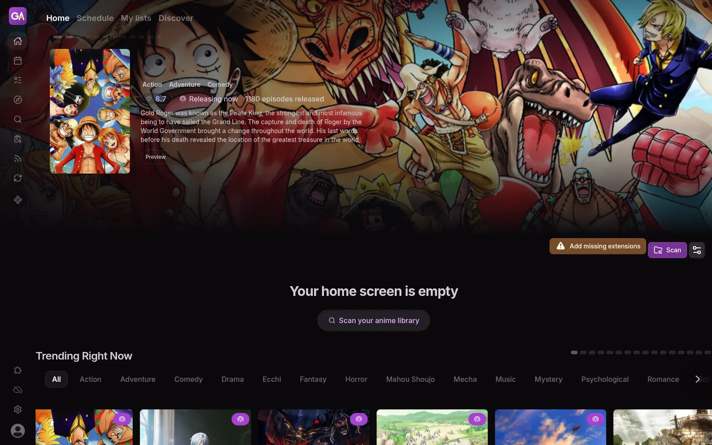
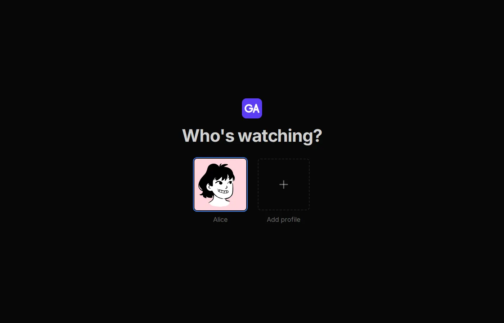
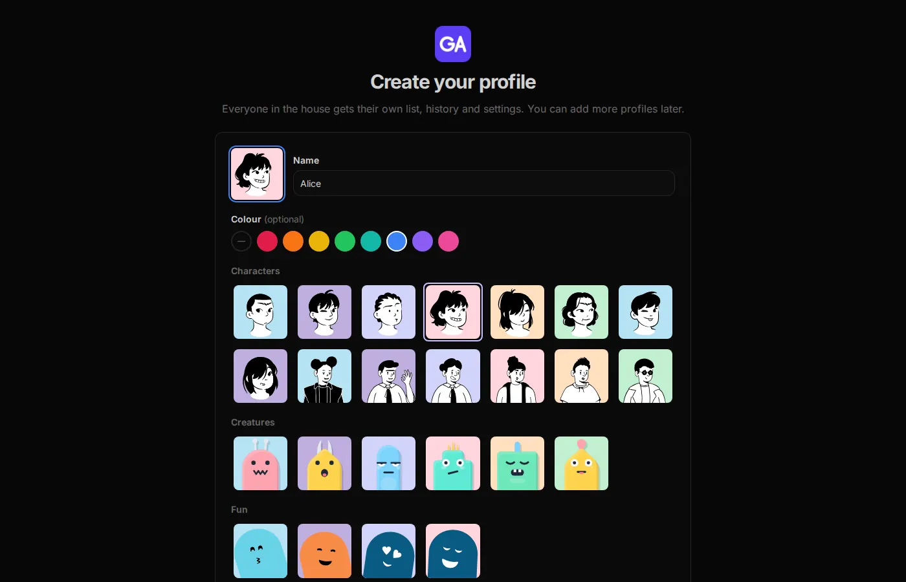
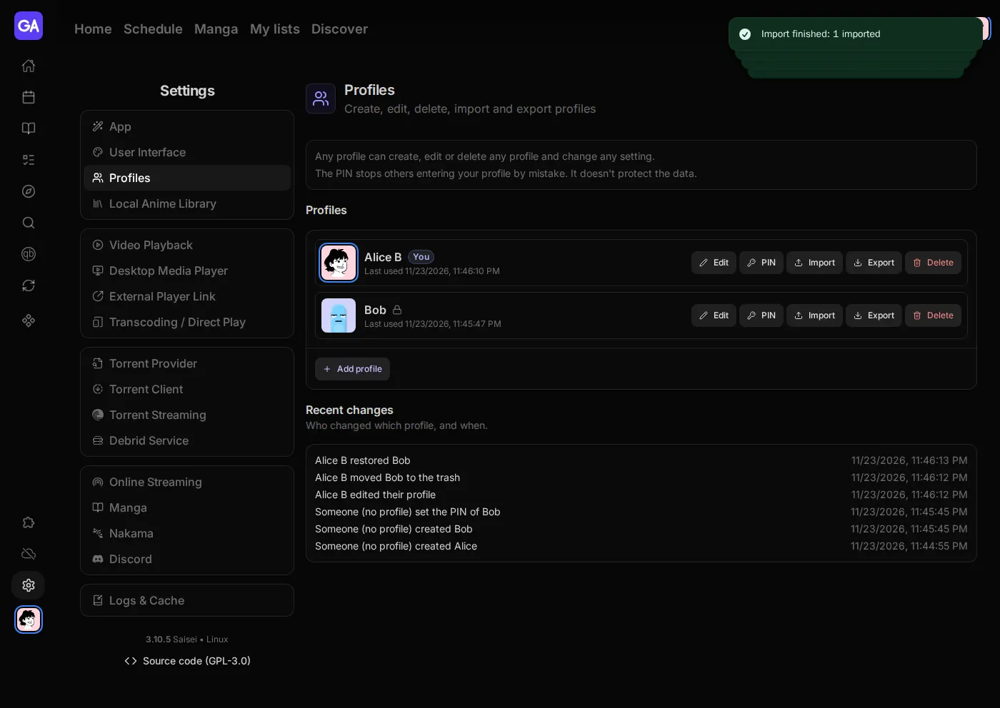
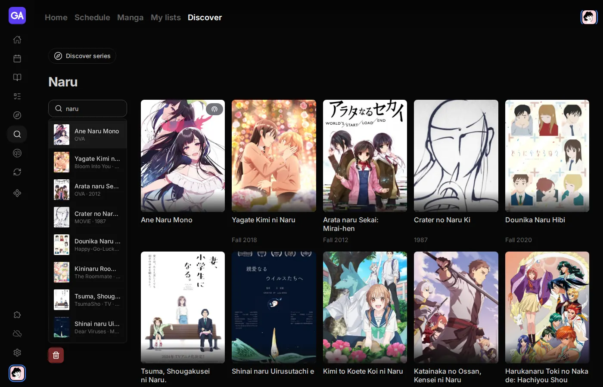
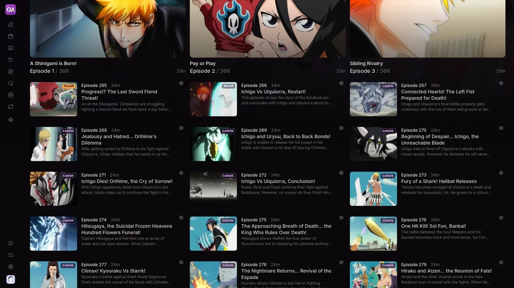
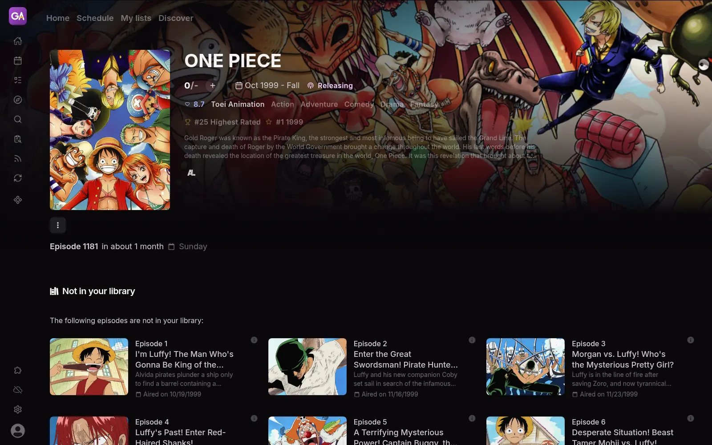
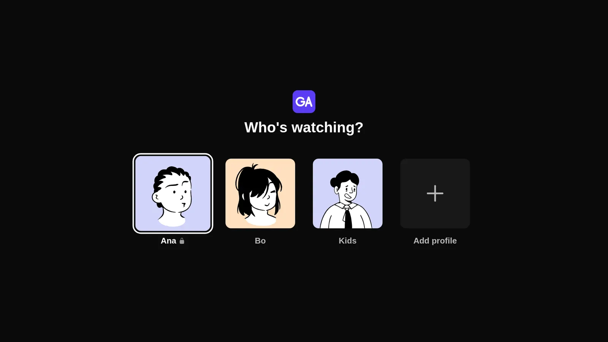
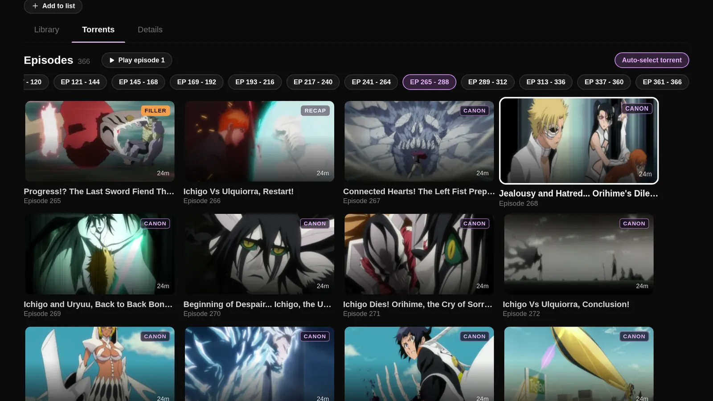

<h1 align="center">Garceslab Anime</h1>

A self-hosted anime media server and web interface, made to work well with LG webOS TVs. 
Based on Seanime and Seanime Tenji (GPL-3.0).

---

> **Not original work.** Garceslab Anime is derived from
> [Seanime](https://github.com/5rahim/seanime) (© 5rahim and contributors) and
> [Seanime Tenji](https://github.com/AlkindiX/seanime-tv) (© AlkindiX and contributors). This
> code is not our property: their authors keep their copyright, and this project only adds
> modifications, under the same GPL-3.0 license. See [Credits & License](#credits--license).

**Status: early development.** Based on Seanime v3.10.5, with local profiles, several viewers at
once, episode tags, a local title index and more (below). The update checker is turned off.

This repository is the **server and web interface**. The LG webOS TV app lives in
[garceslab-anime-tv](https://github.com/YTvictorworld/garceslab-anime-tv). All documentation is in
[`docs/`](docs/README.md).

## What it is

Garceslab Anime is a server you run yourself (Docker) plus a web interface, and a companion TV
app for LG webOS. It is published only so that people can **self-host a version that works with
LG webOS TVs** (tested on webOS 23).

There is **no hosted service**: no website to watch anything on, no accounts, nothing run by
this project. You install and run it on your own hardware.

> [!IMPORTANT]
> Garceslab Anime does not provide, host or distribute any media content. Users are responsible
> for obtaining media through legal means and for complying with the laws of their country.
> Extensions are third-party software, unaffiliated with this project.

## Features

Everything Seanime v3.10.5 does (library scanning, debrid and torrent streaming, online
streaming and torrent providers through extensions, plugins, schedule and the web interface),
plus:

### Profiles: "Who's watching?"

- **Local profiles** without an AniList account, asked for on every launch, on the web and on
  the TV. Each profile has its own list, progress, "Continue watching", watch history, settings
  and **player preferences** (subtitle and audio languages, sizes, autoplay, skipping, …).
- **Avatars** from a bundled, free-licensed catalog (CC0 and CC BY 4.0, credits shown in the
  pickers); an **optional PIN** (4 to 6 digits) per profile.
- **AniList is optional:** it is used anonymously for public metadata. A public list (by user
  name) or a private one (with a one-time token that is never stored) can be imported, and any
  profile can be exported to and imported from **JSON**.
- **Favourites, a full entry editor** (status, score, progress, dates, rewatches, notes,
  private), **custom lists**, and **stats** computed locally.
- **Settings → Profiles** lists the profiles (edit, PIN, import, export, delete with a 30-day
  trash) and **Recent changes**: who created, renamed, imported into or deleted which profile.

More: [docs/profiles.md](docs/profiles.md).

### Up to three viewers at once

Up to **three devices** can watch different debrid (TorBox) episodes at the same time, each with
its own profile and progress. The server only hands out the stream link; the TV plays it
directly and reads the subtitles from the MKV itself. If direct play fails, the TV retries three
times with a fresh link before relaying the stream through the server. **Settings → Profiles →
Now watching** shows who is watching and can stop a session. More:
[docs/phase2-direct-play.md](docs/phase2-direct-play.md).

### Subtitle-aware auto-select

Release names rarely say which subtitle languages a file has. For debrid streams, auto-select
reads the MKV headers of a few cached candidates and prefers one with a full subtitle track in
the **profile's subtitle language**. More: [docs/subtitle-autoselect.md](docs/subtitle-autoselect.md).

### Search as you type

A **local title index** (built from manami-project's anime-offline-database, ODbL) suggests anime
from the first letters of any title or synonym ("ble" → Bleach), which AniList's search can't do.
More: [docs/title-search.md](docs/title-search.md).

### Episode tags: CANON / FILLER / RECAP / MIX

Episode cards show whether an episode is canon, filler, recap or mixed, from MyAnimeList data
read through Tenrai, jikan-edge and Jikan (with failover). The tags also appear on "Continue
watching" and in the player, and the TV can **skip filler and recaps**. More:
[docs/episode-tags.md](docs/episode-tags.md).

### And also

- **Lilac brand and web refresh:** Garceslab Anime's own colour and logo, the *Releasing* badge
  on airing anime, favourites in **My lists**.
- **LG webOS fixes:** debrid streams requested without an HTTP `Range` header (as the webOS
  native player does) are served correctly, so no proxy is needed in front of the server.
- **No auto-update to Seanime and no upstream announcements:** the server is never replaced by a
  Seanime release and doesn't fetch Seanime's announcement feed.

### On the TV

The [TV app](https://github.com/YTvictorworld/garceslab-anime-tv) adds "Who's watching?" with
profile editing on the TV, a Netflix-style **Up next** card, a **Schedule** week calendar, its own
on-screen keyboard with suggestions, and episode cards that start playback in place.

## Install

Run the server with **Docker Compose**: the
[self-hosting guide](docs/self-hosting-webos.md) covers the compose file, the server password,
installing the TV app, the first run, profiles, PINs and the optional AniList import.

- **Server image:** build it from this repository (`docker build -t garceslab-anime-server .`).
  Prebuilt images on `ghcr.io/ytvictorworld/garceslab-anime-server` are *coming with 1.0*.
- **TV app:** the `.ipk` from the TV repository's
  [GitHub Releases](https://github.com/YTvictorworld/garceslab-anime-tv/releases) (*coming with
  1.0*; until then, build it as described there).

The container runs as the unprivileged user `seanime` (uid 1000) and keeps its data in
`/home/seanime/.config/Seanime`. Set a server password before exposing it to your network.

## Documentation and development

- [docs/](docs/README.md): every guide and feature doc, plus the roadmap.
- [CONTRIBUTING.md](CONTRIBUTING.md): how to propose a change (issue first, tests and docs in
  every pull request) and how to build and test.
- [DEVELOPMENT_AND_BUILD.md](DEVELOPMENT_AND_BUILD.md): building from source (inherited from
  Seanime).
- [MODIFICATIONS.md](MODIFICATIONS.md): every change compared with Seanime, with dates.

## Credits & License

Garceslab Anime is **not originally our code**. It is derived from:

- **[Seanime](https://github.com/5rahim/seanime)**, © 5rahim and the Seanime contributors: the
  server and web interface in this repository are derived from Seanime v3.10.5.
- **[Seanime Tenji](https://github.com/AlkindiX/seanime-tv)**, © AlkindiX and contributors
  (based on [Seanime Tenji](https://github.com/5rahim/seanime-tenji) by 5rahim): the TV app in
  [garceslab-anime-tv](https://github.com/YTvictorworld/garceslab-anime-tv) is derived from it.

Search suggestions (prefix "search as you type") come from the
[anime-offline-database](https://github.com/manami-project/anime-offline-database) by
manami-project, available under the [Open Database License (ODbL) v1.0](https://opendatacommons.org/licenses/odbl/1-0/)
(contents under the Database Contents License v1.0). It is not included in this repository: the
server downloads it at runtime into its data directory (`title-index/`, about 6 MB, refreshed
weekly) and serves `GET /api/v1/search/suggest` from it. Set `SEANIME_TITLE_INDEX_DISABLED=true`
to turn it off; clients then use the AniList search only.

Profile avatars are generated with [DiceBear](https://www.dicebear.com) (code under MIT) from
styles licensed CC0 1.0 (Lorelei, Notionists, Critters, Thumbs, Open Peeps by Pablo Stanley,
Pixel Art, Voxel Bot, Clay, Sprouts, Planets) and CC BY 4.0 (**Adventurer** by Lisa Wischofsky,
[source](https://www.figma.com/community/file/1184595184137881796),
[licence](https://creativecommons.org/licenses/by/4.0/)). Every image's licence and source is in
[`internal/profiles/avatars/catalog.json`](internal/profiles/avatars/catalog.json) and
[`LICENSES.md`](internal/profiles/avatars/LICENSES.md); CI rejects avatars without one.

Episode tags (CANON / FILLER / RECAP on episode cards) use [MyAnimeList](https://myanimelist.net)
episode data, read through the Jikan-compatible APIs [Tenrai](https://tenrai.org),
[jikan-edge](https://jikan.lucashdo.com) and [Jikan](https://jikan.moe). The data belongs to
MyAnimeList; this project is not affiliated with MyAnimeList or with these APIs. See
[docs/episode-tags.md](docs/episode-tags.md) for how it is fetched, cached and configured.

Anime titles, covers and banners shown in the screenshots come from AniList's public data, as in
Seanime; they belong to their respective owners.

The original authors keep the copyright on their work, and this project does not claim
ownership of it. All original copyright and license notices are preserved unchanged, and the
full git history is kept, so every upstream commit keeps its author.

The modifications made by the Garceslab Anime contributors are distributed under the same
license, the [GNU General Public License v3.0](LICENSE), with no additional restrictions. The
modifications and their dates are listed in [MODIFICATIONS.md](MODIFICATIONS.md); see also
[NOTICE](NOTICE).

"Seanime" and "Seanime Tenji", and their logos, belong to their respective owners and are used
only to say where this project comes from. Garceslab Anime is an independent, unofficial
project, not affiliated with or endorsed by Seanime or Seanime Tenji: please don't report
Garceslab Anime issues to them.
