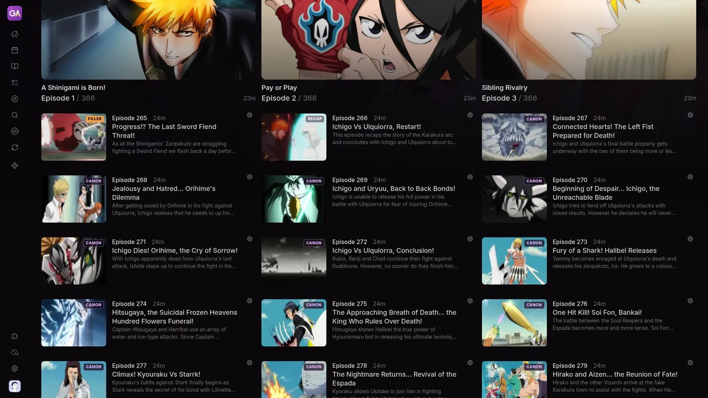

# Episode tags: CANON / FILLER / RECAP / MIX

Episode cards can show whether an episode is **canon**, **filler**, **recap** or **mixed**
(part canon, part filler), so long shows can be watched without the filler.

## Where they show

- **Web:** episode cards on the anime page, "Continue watching", and the autoplay prompt.
- **TV:** episode cards, "Continue watching" and the home hero, the player's top bar, its
  *Next episode* button and the **Up next** card. The TV's player setting **Skip filler and
  recaps** (per profile) makes "next episode" jump over FILLER and RECAP episodes.

Tags are shown only for an anime with at least one filler or recap episode, so an all-canon
show looks as before.

## Where the data comes from

The data is **MyAnimeList's** episode list (looked up by the anime's `idMal`), read through the
Jikan-compatible APIs [Tenrai](https://tenrai.org), [jikan-edge](https://jikan.lucashdo.com)
and [Jikan](https://jikan.moe). Garceslab Anime is not affiliated with MyAnimeList or these APIs.

- `GET /api/v1/anime/episode-tags/{id}` (AniList id) never waits for the network: a cache miss
  queues a background fetch and answers `pending`; clients ask again a few seconds later.
  Answers: `{status: "ready"|"pending"|"unavailable", malId, episodes: {"<n>": "canon"|"filler"|"recap"|"mixed"}, hasNonCanon, fetchedAt, source}`.
- **Failover:** requests go out one at a time, at least 1 s apart per API (1.5 s for
  jikan-edge and Jikan), and rotate to the next API on 429 (honouring Retry-After), 5xx or a
  connection failure. A failing API rests on an exponential cooldown (30 s doubling, up to
  30 min).
- **Cache:** one JSON file per anime in `<data dir>/episode-tags/`, shared by all profiles;
  refreshed daily while airing and every 30 days once finished.

## Limits

MyAnimeList's episode numbers are used 1:1. Anime that MyAnimeList and AniList split
differently (split cours, absolute numbering) can get shifted or missing tags. Specials have
no tag.

## Configuration

| Variable | Default | Meaning |
|---|---|---|
| `SEANIME_EPISODE_TAGS_PROVIDERS` | `tenrai,jikan-edge,jikan` | APIs and their order; `jikan4=<url>` (Jikan v4 shape) or `edge=<url>` (jikan-edge shape) adds another instance |
| `SEANIME_EPISODE_TAGS_DISABLED` | `false` | `true` turns the feature off |

## Code and tests

`internal/episodetags`, `internal/core/episode_tags.go`, `internal/handlers/anime_episode_tags.go`;
the web pill in `seanime-web`. Tests: `go test ./internal/episodetags/`.
