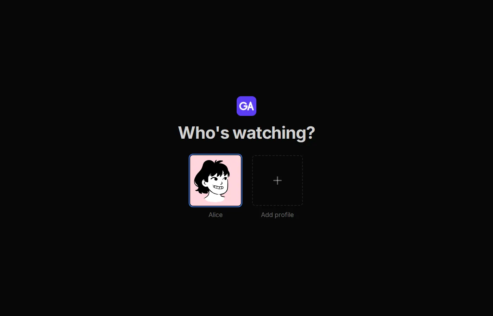
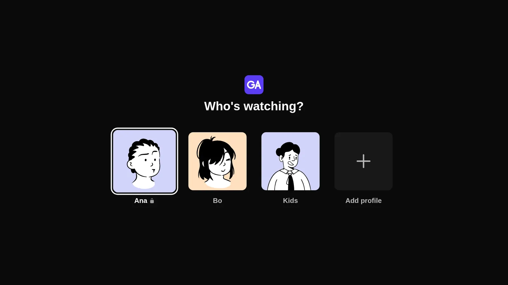
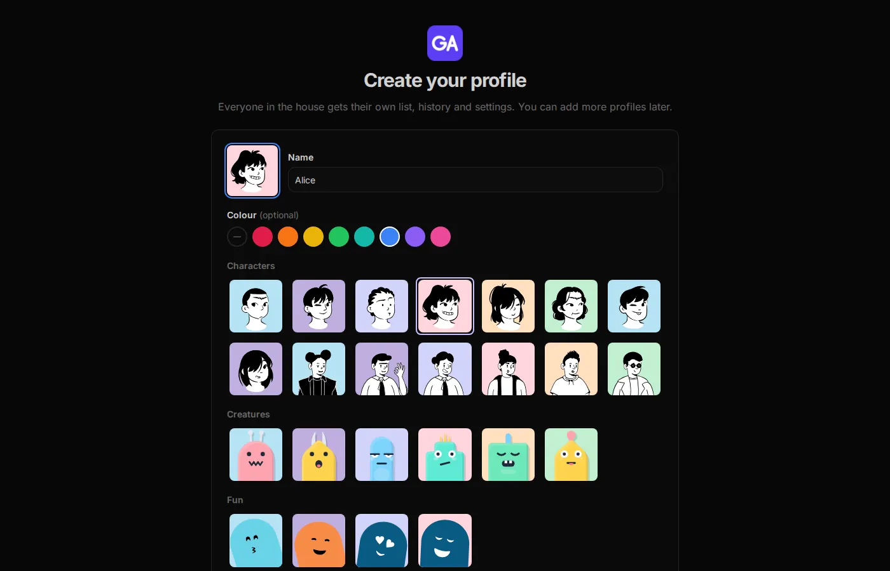
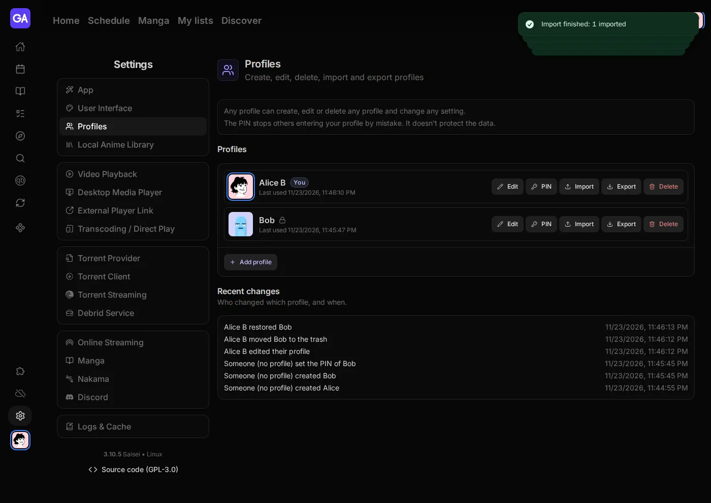

# Profiles

Garceslab Anime replaces Seanime's single AniList account with **local profiles**, like a
streaming service: everyone in the house picks their own profile on launch, and each profile
keeps its own data on your server. No profile needs an AniList account.

## Who's watching?

- The web interface (every page load) and the TV app (every cold launch) ask **Who's
  watching?**. With `SEANIME_PROFILES_ENFORCE=true` the server refuses user-data requests
  without a profile.
- A server without profiles starts with **Create your profile**: a name, an avatar, an
  optional PIN and an optional AniList import.
- Profiles can be created, renamed, given another avatar or colour, re-PINned and deleted on
  the web (**Settings → Profiles**) and on the TV ("Who's watching?" → *Edit*). Deleted
  profiles go to a **trash** and can be restored for 30 days.
- Clients send the profile's session token with every request (`X-Seanime-Profile`, or
  `?profile=` on the websocket). Sessions last at most 24 hours and end when the PIN changes
  or the profile is deleted.

## Avatars

Avatars come from a catalog bundled with the server (`internal/profiles/avatars`), generated
with DiceBear from styles under **CC0 1.0** and **CC BY 4.0** (Adventurer by Lisa Wischofsky).
Each entry in `catalog.json` carries its licence and source, the pickers show the credits the
CC BY styles need, and CI (`.github/scripts/check-avatars.go`) rejects avatars without a
licence. There are no uploads.

## PINs

A PIN (4 to 6 digits) is optional. After five wrong tries the profile is locked for five
minutes. A PIN stops someone entering your profile by mistake; it is **not** a security
barrier (anyone who can use the server can remove it from Settings → Profiles, and that shows
in Recent changes). The server password protects the server.

## What belongs to a profile

- The anime list (statuses, scores, progress, dates, rewatches, notes, private entries),
  **favourites**, **custom lists** and locally computed **stats**.
- "Continue watching", watch history and resume positions.
- Settings and theme, auto-select profile, and **player preferences**
  (`GET/PATCH /api/v1/profiles/me/player-prefs`): the TV's audio and subtitle languages,
  subtitle size, autoplay, next episode, skipping, "Skip filler and recaps", and the web
  player's own section.

Details of favourites, the entry editor, custom lists and stats:
[profiles-phase3.md](profiles-phase3.md).

## AniList is optional

AniList is used **anonymously** for public metadata (titles, covers, search, airing). A list can
be copied into a profile:

- **Public list** by AniList user name, from "Create your profile" or Settings → Profiles →
  Import.
- **Private list** with a one-time access token, used for that request only and never stored.
- **JSON**: every profile can be exported (`GET /api/v1/profiles/:id/export`) and imported back
  (`POST /api/v1/profiles/:id/import/json`), favourites included.

After an import the list lives on your server; nothing is sent back to AniList.

## Recent changes

**Settings → Profiles → Recent changes** lists who created, renamed, deleted, restored,
imported into or exported which profile, and who changed a PIN, with the time
(`profile_audit` table, `GET /api/v1/profiles/audit`). The same page has **Now watching**
(see [phase2-direct-play.md](phase2-direct-play.md)).

## Where it lives in the code

`internal/profiles/` (store, service, PINs, tokens, middleware, sessions, importer, local
platform, avatars) and `internal/handlers/profiles*.go`. Every place where profiles touch
Seanime code is listed in [internal/profiles/HOOKS.md](../internal/profiles/HOOKS.md). Tests sit
next to each package (`go test ./internal/profiles/...`).
