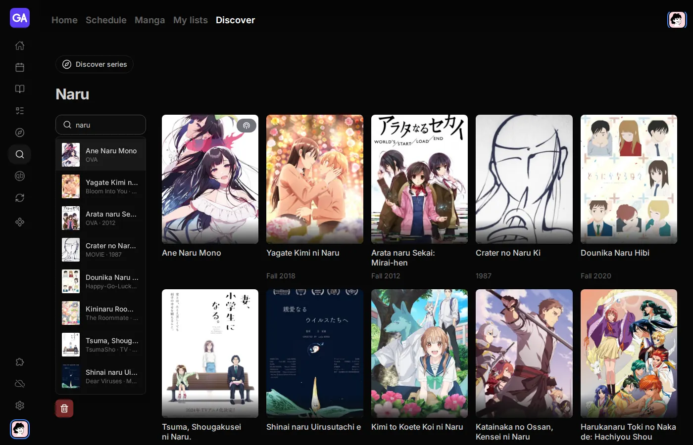

# Search as you type (title index)

AniList's search matches whole words, so "ble" doesn't find Bleach. Garceslab Anime keeps a
small **local title index** so the web and the TV can suggest anime from the first letters of
any title or synonym.



## How it works

- The server downloads manami-project's
  [anime-offline-database](https://github.com/manami-project/anime-offline-database) (ODbL
  v1.0, contents under DbCL v1.0) at runtime into `<data dir>/title-index/` (about 6 MB) and
  refreshes it **weekly**. It is not part of this repository. Only entries with an AniList id
  are kept, and the index is built in memory.
- `GET /api/v1/search/suggest?q=&limit=` returns suggestions for a prefix of any title or
  synonym, with the synonym that matched ("Attack on Titan" for Shingeki no Kyojin).
- Without the database (still downloading, turned off), the endpoint returns an empty list and
  clients fall back to AniList's search.
- The **web** search page's typeahead uses it first; the **TV** shows the suggestions next to
  its own on-screen keyboard (see the TV docs).

## Configuration

| Variable | Default | Meaning |
|---|---|---|
| `SEANIME_TITLE_INDEX_DISABLED` | `false` | `true`: nothing is downloaded; suggestions use AniList only |

## Attribution

The database is © manami-project and contributors under the Open Database License; the
attribution is in the [README](../README.md#credits--license) and [NOTICE](../NOTICE).

## Code and tests

`internal/titleindex` (download, normalisation, prefix index), `internal/core/title_index.go`,
`internal/handlers/search_suggest.go`.

```sh
go test ./internal/titleindex/
```
